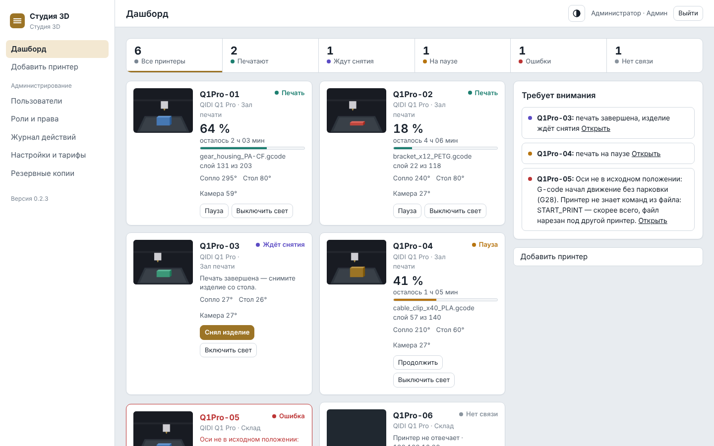
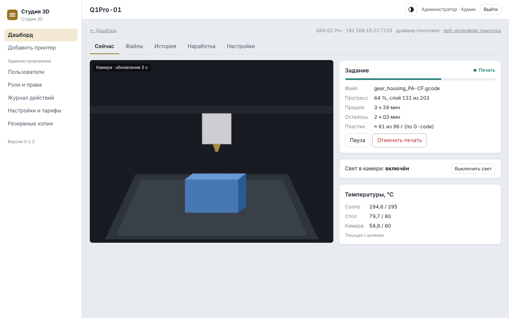
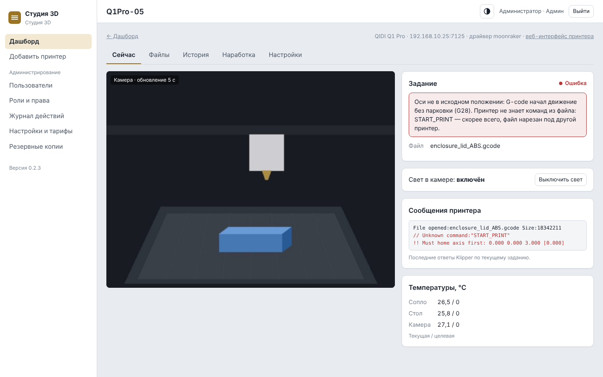
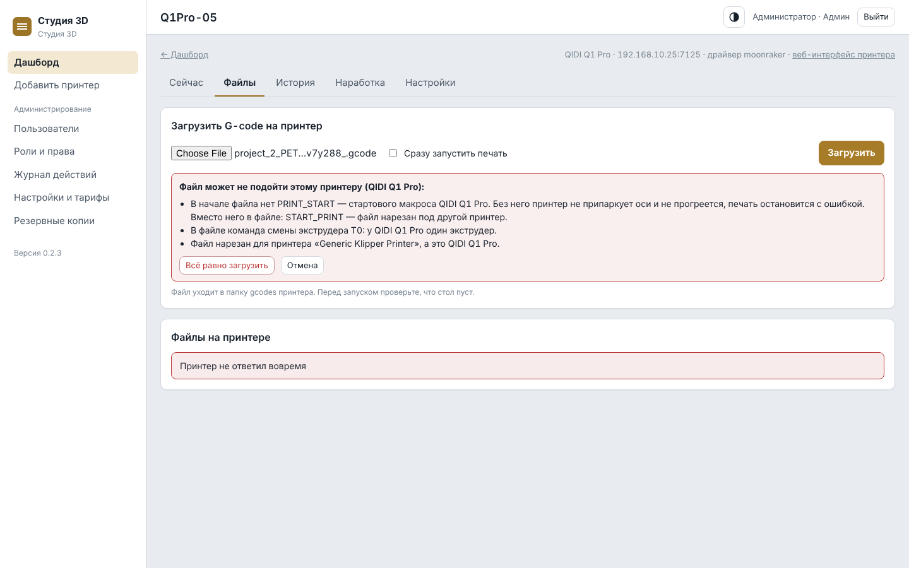
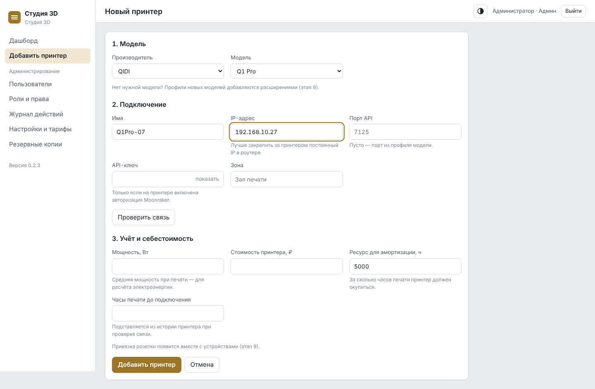
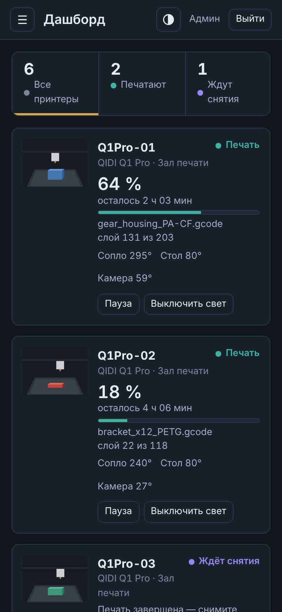

<p align="center">
  
</p>

<p align="center">
  <strong>English</strong> · <a href="README.ru.md">Русский</a>
</p>

<p align="center">
  Self-hosted management system for 3D printing studios and print farms: Klipper / Moonraker printers, cameras,
  G-code checks, machine hours and roles — on your local network, in Docker.
</p>

<p align="center">
  <a href="https://github.com/neiroJob/studio3d/actions/workflows/ci.yml"></a>
  <a href="LICENSE"></a>
  
  
  
  
</p>

Studio3D shows everything that happens in a 3D printing studio in one place: which printers are printing, what is
on the bed, how much time is left, what failed and why, and how many hours each machine has worked. It runs on your
own server inside the studio network — no cloud account, no subscription, nothing installed on the printers.

> **Status: stage 3 of 11 — printers.** Pre-1.0, under active development. Available today:
> - foundation: Docker install, first-run wizard, login with brute-force protection, roles and permissions, users,
>   electricity tariffs, audit log, daily database backups;
> - printers: adding a printer, live dashboard, printer card with camera and light, pause / resume / cancel,
>   start a file, G-code upload with progress and compatibility check, model thumbnails, job history,
>   machine hours, Klipper messages.
>
> Verified on real hardware: **QIDI Q1 Pro** and **Creality K1C** (Moonraker), **Creality K1** (native
> WebSocket). **QIDI Plus 4** is partially verified: connection, camera, light and file actions work; motion controls
> await a printer firmware fault being resolved. More models are added after they are tested on real printers. See
> [CHANGELOG.md](CHANGELOG.md) and [ROADMAP.md](ROADMAP.md).
>
> The user interface is in Russian today; English UI is on the roadmap.

## Screenshots



<table>
  <tr>
    <td></td>
    <td></td>
  </tr>
  <tr>
    <td></td>
    <td></td>
  </tr>
</table>

<p align="center"></p>

All screenshots use synthetic demo data (`python manage.py demo_data`); they contain no real addresses or orders.

## What Studio3D does

- **Live dashboard** for the whole farm: status, progress, layer, time left, temperatures and a camera preview for
  every printer; filters by state and an "attention needed" list (errors, paused prints, parts waiting to be
  removed, heaters left on without a print).
- **Printer card**: camera, current job, grams of filament from G-code metadata, temperatures of nozzle, bed and
  chamber, case light, pause / resume / cancel, files on the printer, upload with a two-stage progress bar.
- **G-code compatibility check** before upload and start: missing start macro (e.g. `PRINT_START` on QIDI), foreign
  start macros (`START_PRINT`), tool changes on a single-extruder printer, `; printer_model` mismatch.
- **Errors in plain language**: common Klipper errors are explained, unknown commands from the file are listed,
  recent Klipper responses are shown in the card.
- **"Part removed" workflow**: after a successful print the printer waits until an operator confirms the bed is
  clear; starting a new job is blocked until then.
- **Machine hours**: print hours (history imported from the printer + jobs recorded by the system) and power-on
  hours.
- **Roles**: admin, manager, operator and custom roles; several roles per login.
- **Audit log**, **daily PostgreSQL backups** with download from the web UI, **dark and light theme**, mobile layout.
- **Extensible printer support**: a new model on a supported protocol is a YAML profile, not code.

### Roadmap highlights

Telegram notifications and camera timelapses · filament stock with automatic consumption · CRM and exact job cost
(filament, electricity, depreciation, rent) · maintenance schedules · MQTT devices (smart plugs, climate control) ·
more printer models · extension packages · English UI. Full plan: [ROADMAP.md](ROADMAP.md).

## Supported printers

Nothing is installed on the printers; Studio3D talks to the stock firmware.

| Vendor | Model | Driver | Status |
| --- | --- | --- | --- |
| QIDI | Q1 Pro | moonraker | ✅ profile verified on a real printer |
| QIDI | Plus 4 | moonraker | ⚠️ connection, camera, light and file actions verified; motion controls pending |
| QIDI | Q2 | moonraker | planned, after testing on hardware |
| Elegoo | Neptune 4 Max | moonraker | planned, after testing on hardware |
| Creality | K1C (2025 revision) | moonraker + port 9999 for the light | ✅ verified on two printers, incl. starting prints |
| Creality | K1 | creality_native (WebSocket 9999) | ✅ verified on a real printer, incl. starting prints |
| Creality | early K1C revisions | creality_native | planned, after testing on hardware |

Any Klipper printer with Moonraker should work with a new profile — see
[adding a printer model](README.ru.md#125-новая-модель-принтера-и-тесты-драйвера) and the
[printer support request](https://github.com/neiroJob/studio3d/issues/new?template=printer_support.yml) template.

## Quick start

Requirements: Ubuntu Server 22.04 / 24.04 / 26.04 (any Linux with Docker should work), Docker Engine with the
Compose plugin, and network access from the server to the printers.

```bash
git clone https://github.com/neiroJob/studio3d.git
cd studio3d
bash install.sh
```

`install.sh` creates `.env` with random secrets, builds and starts the containers and prints the address to open.
Open `http://<server-ip>` and complete the first-run wizard (administrator, studio name, time zone, electricity
tariff). Then use **«Добавить принтер»** (Add printer): choose the model, enter the IP address and press
**«Проверить связь»** (Check connection).

Update to the latest version:

```bash
bash update.sh
```

The detailed guide — Docker installation, backups and restore, `.env` settings, development mode, troubleshooting —
is in [README.ru.md](README.ru.md) (Russian).

## Architecture

```
  browser (LAN) ──:80──► proxy (Caddy) ──► web (Django + HTMX, gunicorn)
                                              │           │
                                              ▼           ▼
                                        db (PostgreSQL)  redis ◄── collector (asyncio) ◄──► printers
                                              ▲                     WebSocket / HTTP (Moonraker)
                                        backup (pg_dump daily)
```

| Container | Role |
| --- | --- |
| `web` | Django 5.2 + HTMX UI, roles, audit log, commands to printers |
| `collector` | Keeps a WebSocket connection to every printer, writes live state to Redis and finished jobs to PostgreSQL, reconnects automatically |
| `db` | PostgreSQL 16 |
| `redis` | Live state, login throttling, cache |
| `proxy` | Caddy on port 80, static files |
| `backup` | Daily `pg_dump` with retention |

## Security

- Designed for the studio's **local network**; no inbound access from the internet is required.
- Passwords are hashed; printer API keys are encrypted in the database.
- Login throttling per IP, CSRF protection, audit log of every printer command.
- Report vulnerabilities privately — see [SECURITY.md](SECURITY.md).

## License

Studio3D is **source-available** under the [Business Source License 1.1](LICENSE). It is not an OSI-approved open
source license. In short:

- ✅ **Free** to install and run your own studio or print farm — including when your studio earns money by printing.
- ✅ Read, modify and fork the code; send improvements.
- ❌ A **commercial license** is required to sell Studio3D or a product built on it, offer it as a hosted / SaaS
  service, charge for installation or support based on it, or bundle it with hardware you sell.
- ⏳ Each version converts to the Apache License 2.0 four years after its release.

Plain-language explanation: [LICENSING.md](LICENSING.md). Commercial licensing: open an issue labelled
"commercial license" or contact Telegram [@free_bird1987](https://t.me/free_bird1987).

## Contributing

Bug reports, printer profiles and pull requests are welcome — see [CONTRIBUTING.md](CONTRIBUTING.md). Contributions
require agreeing to the [Contributor License Agreement](CLA.md) so the project can keep offering commercial licenses.

## Support

Questions and ideas: [GitHub Issues](https://github.com/neiroJob/studio3d/issues) · Telegram
[@free_bird1987](https://t.me/free_bird1987). See [SUPPORT.md](SUPPORT.md).

<sub>Klipper, Moonraker, QIDI, Creality, Elegoo and other names are trademarks of their respective owners; Studio3D is
not affiliated with them.</sub>
